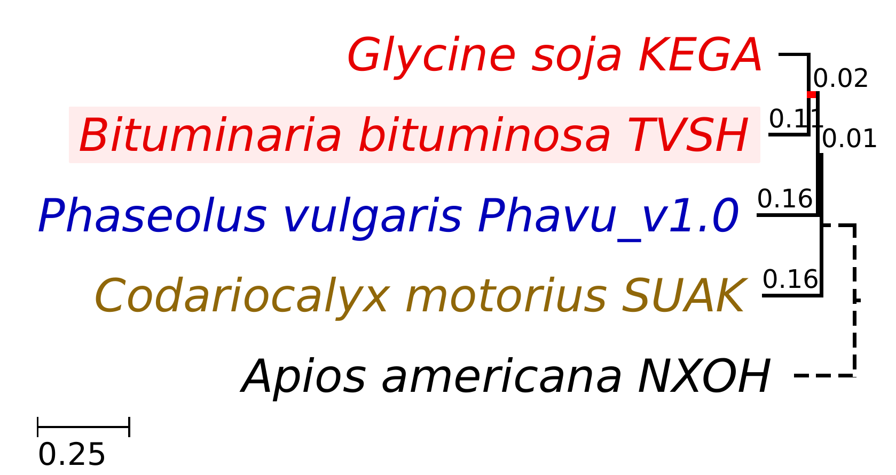
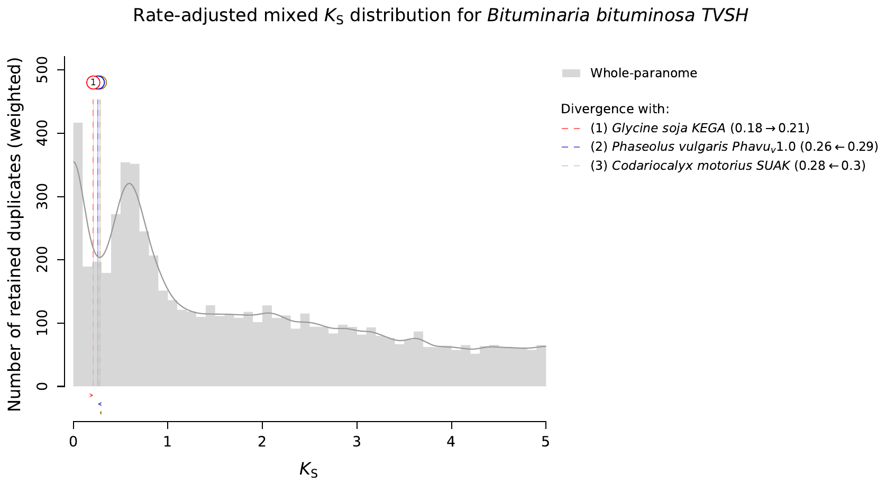
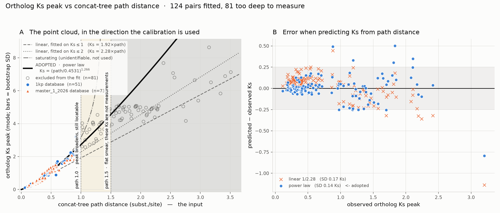
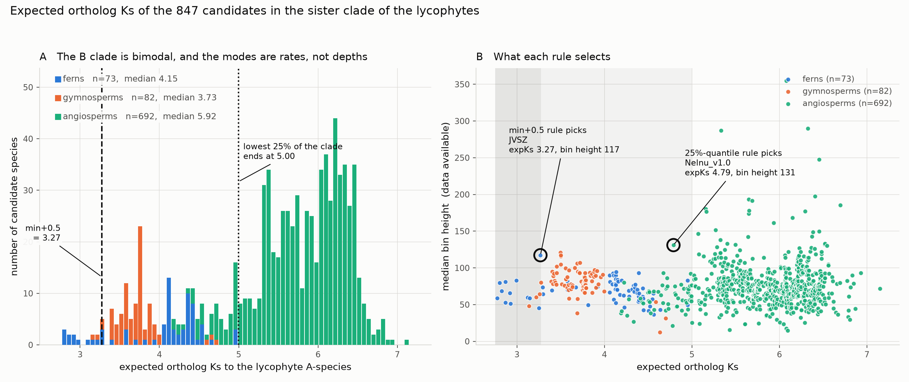
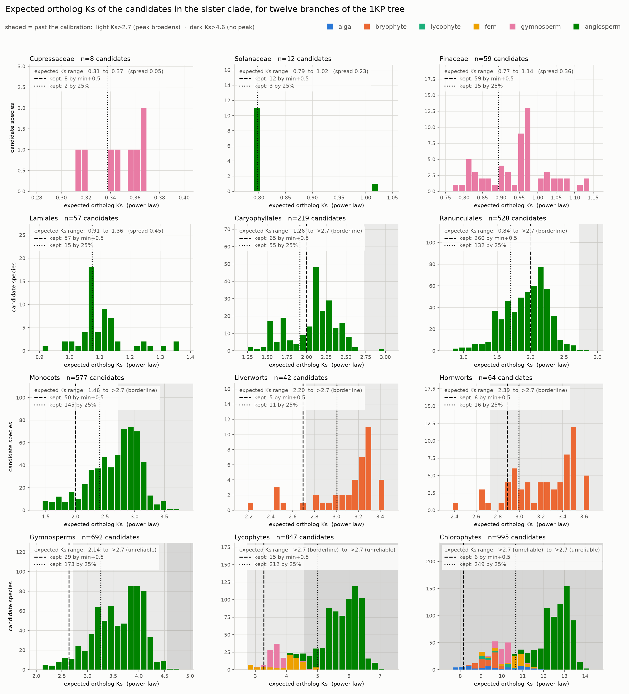

# How the A/B/C/D datasets are built — the big picture

Short overview, written to be read on its own. The two long documents in this folder give the
measurements, the rejected alternatives and the implementation; this one gives the shape of the
method and the reasoning behind each choice.

- `01_subtree_construction.md` — what a branch dataset is and how the script builds it
- `02_calibration_methods.md` — the calibration, the selection rule, and the validation behind both

---

## 1. The problem

The 1KP paper inferred whole-genome multiplications (WGMs) across a phylogeny of **1178 species**
and **2354 branches**. We re-examine every one of those branches independently with ksrates.

ksrates cannot be run on 1178 species at once, and it should not be: a Ks analysis compares a
focal species' *paranome* (its own duplicate pairs) against *ortholog* divergences with a few
relatives. So each branch gets its own small dataset — a handful of species chosen to answer one
question: **did a WGM happen on this branch?**

## 2. What a branch dataset is

For a test branch, the clade below it is **A**. Walking up towards the root, the sibling clades
met on the way are **B**, then **C**, then **D**.



Here the focal species is *Bituminaria bituminosa* (TVSH). **A** is red (TVSH plus *Glycine
soja*), **B** blue (*Phaseolus vulgaris*), **C** dark yellow (*Codariocalyx motorius*), **D**
black and dashed (*Apios americana*). Sizes are capped: **≤4 species in A, ≤2 in each of B, C,
D**.

The logic of the roles:

- **A** supplies the species whose paranome Ks distribution must *show* the putative WGM — a peak
  at the right Ks — or fail to show it.
- **B, C and D** supply ortholog divergences at increasing depth. Their job is to place the
  divergence lines on the Ks axis, which is what lets ksrates say whether a duplication peak sits
  *before* or *after* the test branch, and to correct for substitution-rate differences between
  lineages.



The grey histogram is A's paranome; the coloured vertical lines are the ortholog divergences with
B, C and D after rate adjustment. A WGM on the test branch means a paranome peak **younger** than
the B divergence line.

## 3. Why choosing representatives is the hard part

A clade can hold hundreds of species and we may take only two. Three different things are asked
of a representative, so there are three criteria: one about its own Ks distribution, and two
about the ortholog peaks it will have to form.

### Criterion 1 — can this species' Ks distribution carry the analysis?

Applies to every clade. Transcriptomes differ enormously in how many usable duplicate pairs they
yield; a sparse paranome shows no peak whether or not a WGM happened.

The indicator is the **median bin height**: build the species' paranome Ks distribution with
node-weighting (each duplication node contributes a total weight of 1), take the 20 bars spanning
Ks 0.5–2.5, and record their median. Thresholds: below 20 unusable, 20–30 borderline, above 30
usable.

This was validated against blind visual labels on 64 species — someone scoring the distributions
by eye without seeing the numbers. **AUC 0.894**, and the median beats the simpler "total number
of Ks values" (AUC 0.900 but driven by transcriptome size rather than by peak quality).

### Criterion 2 — will the ortholog Ks peak with this outgroup be measurable?

Applies to B, C and D only. If the A–B split is too old, synonymous sites are saturated: the
ortholog Ks distribution has no peak, and the divergence line cannot be drawn.

We cannot know that in advance without running the analysis — which is the thing we are trying to
plan. So we **predict** it from the species tree, using the branch lengths of the concatenated
protein alignment ("path distance", in amino-acid substitutions per site).


### Criterion 3 — will the peak between that representative and its own outgroup be measurable?

Applies to B and C. The rate adjustment does not use one ortholog peak but three:
`Ks_adjusted = ( Ks(A,B) + Ks(A,O) − Ks(B,O) ) / 2`. The third is *subtracted*, and it moves when
the representative moves, so criterion 2 — which only looks at the distance to A — does not keep
it measurable. A sister can sit comfortably close to A and still be too far from the outgroup for
their shared peak to exist.

The gap between the two distances is fixed before any sister is chosen: with `a`, `b` and `o` the
path lengths from the A/B split down to A, B and O, `path(B,O) − path(A,B) = o − a`, and the
sister's own branch cancels. So the new condition is the old one with a tighter ceiling.

## 4. The calibration: path distance → expected ortholog Ks



Against 205 species pairs whose ortholog Ks peak we actually measured, the relationship is
**concave**: a single conversion factor fitted on shallow pairs underestimates deep ones, which is
the dangerous direction — an underestimate lets a saturated species through the budget. The
adopted form is a power law:

```
expected Ks = (path / 0.4531) ^ 1.266
```

Median error 7.7% below Ks 2, 6.6% below Ks 1 — better than every alternative tried, including
the linear factors and two saturating forms.

## 5. The thing that changed the method: the peak stops existing

The deep end of that figure is drawn with **hollow circles, excluded from the fit**. This is the
central result.

Ortholog Ks "peaks" recorded past a path distance of about 1.0 are not measurements. The
distributions there are flat smears against the `max_ks_orthologs` cutoff: at path 3.4, 85–93% of
Ks values exceed 10 and the remainder is near-uniform from Ks 3 to 10. The "peak" is wherever the
density estimator happens to land.

Measured as **concentration** — the fraction of Ks values within ±0.5 of the mode, where a flat
smear scores 10%:

| path | 0–0.6 | 0.6–0.8 | 0.8–1.0 | 1.0–1.2 | 1.2–1.5 | 1.5–1.8 | 1.8–2.4 |
|---|---|---|---|---|---|---|---|
| concentration | 68% | 55% | **41%** | 21% | 20% | 17% | 16% |

A real mode survives to about **path 1.0** and is gone by **1.5**. Two independent checks agree:
two different mode estimators locate the peak to within 1–2% of each other below path 1.5 and
then disagree by ~0.9 Ks; and an apparent "ceiling" at Ks 5.10, which an earlier version of this
method treated as a biological limit, rose to **8.63** as soon as twelve more pairs were added —
it was simply the maximum of the sample.

**In tree terms**: path 1.0 is roughly the monocot–eudicot split; path 1.5 is roughly the
seed-plant/lycophyte split. Path is substitutions, not time, so a slow lineage buys depth —
*Amborella*–*Pinus* is 0.95 where *Arabidopsis*–*Pinus* is 1.58 for the same divergence.

## 6. The decision this forced, and why we did not take the obvious one

The obvious response is to refuse any outgroup beyond path 1.0: if the ortholog Ks peak cannot be
measured, it cannot anchor a rate adjustment. **We deliberately do not do this.**

Two reasons. First, this survey exists to re-examine 1KP's WGM calls, which *include* the deepest
branches of the tree; a method that declines to analyse them cannot check them. The land-plant
branches a hard limit would exclude are exactly the backbone splits — bryophyte/vascular,
lycophyte/euphyllophyte, fern/seed-plant, gymnosperm/angiosperm. Second, the refusal would be
misdirected: **selection needs only an ordering**, and path distance stays monotone in divergence
whether or not Ks has saturated. What becomes invalid is the quoted number, not the choice.

So every branch is analysed, and the output carries a **reliability level**: *reliable* to path
1.0, *borderline* to 1.5, *unreliable* beyond. Crucially the flag belongs to the **rate adjustment**,
not to the WGM call — A's own paranome distribution does not care how distant the outgroup is.
The honest caveat on a flagged branch is "**branch assignment uncertain**", not "WGM call
invalid".

Cost, over all 7054 B/C/D slots: the chosen representative is reliable in **87.3%**, borderline in 6.3%,
unreliable in 6.4%. It is cheap because the 1KP sampling is dense — the closest available outgroup
has a median path of 0.18 — and the losses are **almost entirely algal** (210 of 218 branches that
a hard limit would drop). Angiosperm branches lose nothing at all.

## 7. The rule as it stands

For each test branch:

1. **A** — each direct child subclade contributes its best 2 species by median bin height, capped
   at 4.
2. **B, C, D** — the sibling clades met walking to the root. Every leaf is a candidate. They are
   settled **oldest first**, D then C then B, so that each representative is chosen already
   knowing the outgroups it will later be measured against.
3. For each candidate, take the **median path distance to the A species**, and convert it to an
   expected Ks with the power law.
4. **Budget** = `max(2.0, lowest expected Ks in the clade + 0.5)`. The `min + 0.5` arm makes it
   adaptive: when a whole clade is deep, the budget opens around its least-deep member, so a
   representative is always returned rather than none.
5. **Second ceiling** (criterion 3): the candidate must also keep its path to every outgroup
   already chosen inside the measurable range, a path of 1.0. Since the offset `o − a` is a
   property of the focal species and the outgroup alone, this is the same condition with a
   smaller limit, `path(A,B) ≤ 1.0 − (o − a)`, and costs one subtraction per outgroup. A
   candidate has to clear both ceilings, so the budget becomes the smaller of the two.
6. **Pick** the candidate(s) with the **highest median bin height** inside the budget.
7. Where no candidate clears both ceilings, keep the least bad one — fewest saturated outgroups
   first, then bin height — and **flag** the branch instead of dropping it, so every branch still
   gets a dataset.
8. **Flag** the result by path distance, and afterwards confirm the flag against the ortholog Ks
   distribution the run actually produced.

Step 6 is worth noticing: within the budget, the expected Ks no longer decides anything. Species
that close together in divergence are indistinguishable given a calibration error of ~0.2 Ks, so
the choice is made on Ks-distribution quality instead. This is also why a **quantile** budget
(e.g. "take the lowest 25%") was rejected: a quantile is relative, so in a tight clade it cuts on
differences far smaller than the calibration's own error, and in a bimodal clade it does the
opposite — in the lycophyte sister clade its lowest quarter reaches Ks 4.47 and selects *Nelumbo*
at 4.29 over an *Equisetum* at 2.98.



That clade is bimodal because its two modes are **substitution rates, not divergence times**: the
ferns and gymnosperms in it are slow, the angiosperms fast, and they split from the lycophytes at
the same moment. Any rule reading the shape of this distribution as depth is reading rate.



Twelve representative branches. Where a panel is a single colour, the sister clade falls entirely
within one lineage — the sister of the gymnosperms *is* the angiosperms — and the choice is being
made within one rate regime. The shaded bands mark where the peak broadens and where it stops
being measurable.

## 8. Status

**Implemented** in `make_branch_subtrees.py` as `--selection paranome` (the default), with the
criterion-3 ceiling controlled by `--outgroup-term-limit`. The earlier BUSCO + TransRate assembly
score is kept as `--selection quality`; it scored the *assembly* rather than the Ks distribution,
which is the thing the analysis actually needs.

**Verified** against the reference implementation over the whole tree: 2354/2354 A selections and
7054/7054 B/C/D selections identical.

**Run**: ten fern branches end to end in November, then the whole fern shard.

**What criterion 3 changed.** Only 45 of the 2354 branches end up with different species — in
almost all the rest no better candidate exists, so the pick stands and the flag fires instead.
The result worth having is the flag: 375 branches (16%) have a B whose subtracted term cannot be
made measurable by any choice, and 347 (15%) the same for C, all of them previously reported as
*reliable*. Purpose-built datasets then showed that this is not a theoretical defect — an
outgroup whose subtracted term is saturated places the divergence 22–61% away from where the
measurable outgroups agree, in six comparisons out of six.

**Open questions:**

1. Should the borderline band (path 1.0–1.5) be treated as usable-with-warning, or folded into
   unreliable? 6.3% of slots sit there.
2. Deep branches currently get a representative chosen on bin height among candidates that are
   all unmeasurable. Is there anything better to rank them on?
3. The saturation result rests on six comparisons in one clade, and saturation is confounded
   there with the outgroup's lineage. Can the confound be broken anywhere in this tree?
4. Dropping D would make about 60% of the flagged cases vacuous, at the cost of a three-clade
   dataset. Not taken — but not formally decided either.
